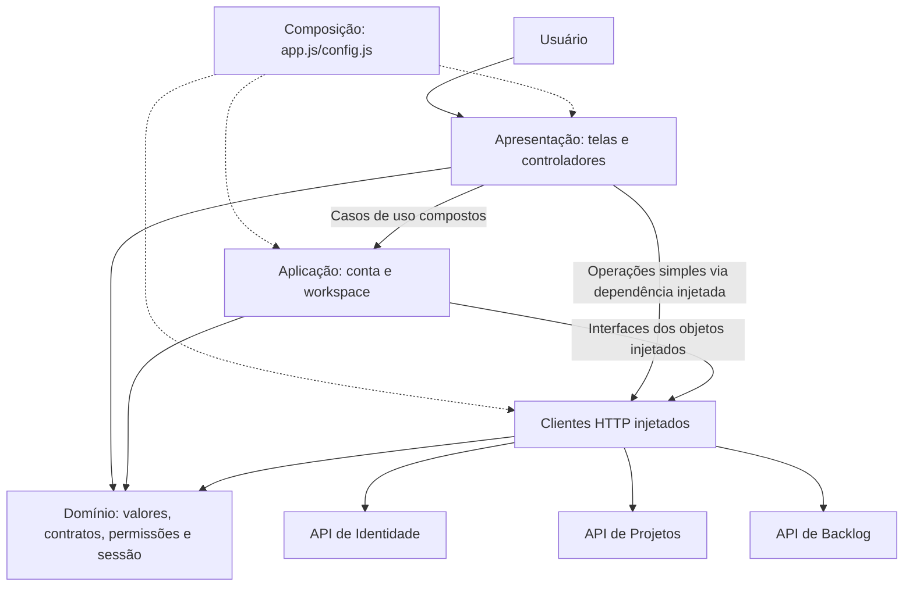
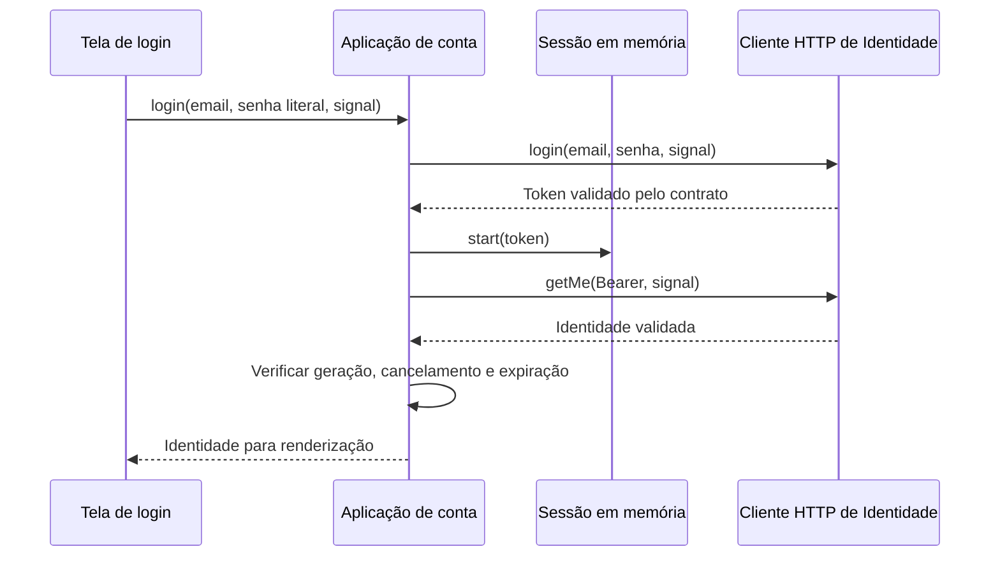

# Arquitetura do frontend

O módulo usa microsserviços de Identidade, Projetos e Backlog. Este repositório
contém o cliente web, organizado em camadas lógicas com módulos ES nativos,
HTML e CSS. O frontend não é um quarto backend e não possui banco próprio.

## Responsabilidades e componentes reais

| Camada | Componentes | Responsabilidade |
| --- | --- | --- |
| Apresentação | `public/index.html`, `styles/app.css`, `styles/workspace.css`, `styles/premium.css`, `app.js`, `projects.js`, `backlog.js`, `collaboration.js`, `professional-profile.js`, `public-auth-controller.js`, `workspace-controller.js`, `workspace-view.js`, `validation.js` | Eventos, campos, renderização, mensagens, foco, acessibilidade e ciclo de vida das telas. Os controladores recebem clientes por injeção; não executam `fetch`. |
| Aplicação | `account-application.js`, `session-application.js`, `workspace-application.js` | Coordenar login, identidade, sessão/renovação, troca de senha e leituras compostas de backlog/membros com permissões atuais. Sem DOM, URLs ou clientes HTTP concretos. |
| Domínio e contratos | `auth-domain.js`, `project-domain.js`, `story-domain.js`, `collaboration-domain.js`, `planning-domain.js`, `validation-rules.js`, `permissions.js`, `session.js`, `api-errors.js` | Valores válidos, normalização, contratos de resposta, permissões, seleção de alterações e sessão em memória. Sem transporte ou DOM. |
| Infraestrutura | `api.js`, `projects-api.js`, `backlog-api.js`, `platform-api.js`, `service-readiness.js` | HTTP, Bearer, serialização, status, timeout, cancelamento, preparação dos serviços e validação de respostas com contratos puros. |
| Composição | Inicialização de `app.js` e `config.js` | Construir clientes concretos, sessão, casos de uso, controladores e callbacks. É o ponto que conhece as demais camadas. |

Os nomes na tabela são relativos a `public/scripts/`, exceto caminhos explícitos.
As camadas são responsabilidades, não novos diretórios obrigatórios. A separação
não implica Clean Architecture ou um conjunto de interfaces abstratas.

Os controladores ainda coordenam o ciclo de cada tela, seu cancelamento e a
confirmação visual depois de gravações. Operações CRUD simples chamam o cliente
injetado; criar um serviço que apenas repassasse todos os mesmos argumentos não
adicionaria uma regra ou caso de uso. Fluxos que combinam operações ou possuem
estado de negócio ficam nos módulos de aplicação. Os testes verificam que telas
não importam implementações de clientes HTTP; apenas a composição as constrói.

## Conta e sessão

`createAccountApplication({ api, session })` coordena login e obtenção da
identidade. O token só é usado depois de uma resposta válida. Falha na consulta
da identidade descarta a sessão criada. Logout invalida a geração da operação;
respostas antigas não restauram a sessão nem apagam um login posterior.

`session.js` depende somente do contrato puro de autenticação. JWT permanece
em memória, sem persistência em localStorage/sessionStorage. Recarregar a página
exige novo login. Apenas a preferência de tema persiste. Na versão 0.5.0,
`session-application.js` coordena renovação compartilhada e descarte de respostas
tardias. Logout revoga a sessão no servidor; troca/reset de senha revogam todas
as sessões. Projetos e Backlog verificam o estado online na Identidade, além da
assinatura JWT. Essa capacidade foi adicionada após a refatoração inicial.

## Projetos, colaboração e backlog

`workspace-application.js` reúne projeto atual e histórias, ou projeto, catálogo
de papéis e membros. A apresentação só recebe o resultado composto se todas as
leituras tiverem sucesso. A ausência de acesso não é substituída por permissões
anteriores. As verificações de geração/token/visibilidade continuam nos
controladores para descartar resultados de uma tela fechada.

`storyChange` seleciona os campos conforme as permissões: Desenvolvedor envia
somente status; quem pode refinar também envia prioridade e textos alterados.
`buildProfileDraft` normaliza competências e valida disponibilidade sem acessar
campos HTML. Datas/validade de convites estão em `collaboration-domain.js`.

A autorização efetiva pertence aos servidores. Ocultar controles não concede
nem comprova acesso. Backlog consulta permissões na API de Projetos com o mesmo
Bearer; cada backend valida JWT usando sua configuração confiável.

## Verificação e execução

- `tests/test_layer_dependencies.py`: direção dos imports e proteção contra
  dependências diretas de DOM, armazenamento e transporte nas camadas puras.
- `tests/test_account_application.py`: login, falhas, cancelamento, expiração,
  logout concorrente e execução dos casos de uso e domínio em Worker, sem DOM e
  com acesso direto a fetch bloqueado.
- `tests/test_domain_values.py`: normalização, limites, duplicatas e expiração.
- `tests/test_workspace_application.py`: leituras compostas e campos por papel.
- Suítes existentes: transporte, navegador, permissões, rascunhos e integração
  com as três APIs reais usando bancos temporários locais.

O comando e os resultados observados estão em [verification.md](verification.md).
Os novos módulos de sessão, planejamento, recuperação e administração estão
descritos em [local-user-stories.md](local-user-stories.md).
O [README](../README.md) contém a execução. PostgreSQL é o banco dos serviços em
produção; as fixtures de navegador usam SQLite temporário e não acessam Neon.
