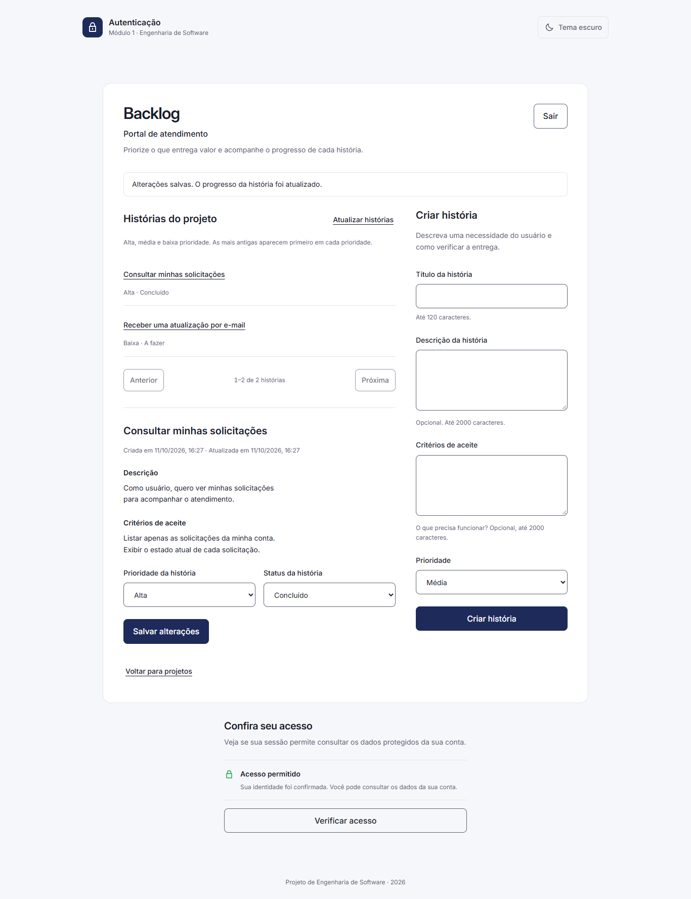
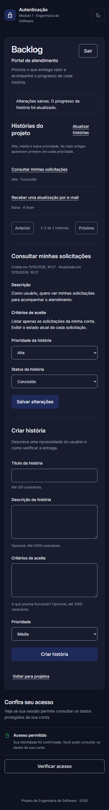

# Validação do frontend 0.2.0 — 11/10/2026

## Colaboração/perfil 0.4.0 — 28/10/2026, somente local

- Suíte completa: **96 testes aprovados, nenhum skip**, em 131,831 s, com as três
  APIs reais e SQLite/RSA temporários. Nenhuma credencial ou banco remoto.
- Teste ampliado de duas contas passou separadamente em 13,943 s: código de convite,
  perfil, acesso Desenvolvedor/status, promoção a PO na UI/API, remoção e código usado negado.
- Backends completos com PostgreSQL descartável: Identidade 200, Projetos 137,
  Backlog 194 aprovados sem skips. ICU und preserva os testes de busca Unicode.
- Seis capturas locais em `.impeccable/review/`: perfil, backlog Desenvolvedor e
  membros; desktop claro 1366×900 e celular escuro 390×844, sem overflow horizontal.
  Revisão visual própria preservou Inter, tokens e identidade do módulo 6.
- Detector Impeccable manteve avisos históricos de paleta/Inter definidos pelo guia;
  não representam troca de marca ou dependência nova.
- Revisão independente deste lote indisponível por limite dos auxiliares;
  revisão própria e testes concluídos. Evidências históricas abaixo não a substituem.
- Tudo local: sem publicação, deploy, tag, push ou alteração de main.

Windows, Python 3.12.15 e Playwright com Microsoft Edge. A suíte completa executou
**63 testes aprovados, sem skips**, com os três caminhos de backend configurados.
O backend do backlog executou 118 testes aprovados e um skip PostgreSQL local opt-in.

Os quatro componentes foram exportados somente com arquivos públicos para árvores
novas; ambientes Python 3.12 foram instalados do zero e a suíte integrada foi
reexecutada usando exclusivamente esses checkouts, sem configuração privada do desenvolvedor.

## Evidência integrada

Cadastro pelo navegador → login → projeto → duas histórias → prioridade alta e
status concluído → reinício do backlog → história recuperada. Outra conta recebeu
404 nas quatro operações; história de outro projeto também ficou inacessível.
Sem token, 401. As três APIs desse teste usam apenas SQLite/RSA/contas temporários.

Separadamente, a instância de desenvolvimento no Neon confirmou TLS verify-full,
schema `backlog`, runtime com SELECT/INSERT/UPDATE e ausência de CREATE/DELETE/acesso
às tabelas dos outros módulos. Criação, alteração, leitura e recuperação após
reinício da API foram verificadas sem exclusão de registros ou schemas.

## Interface

Formulários validam título 1–120 Unicode e descrição/critérios até 2000; foco vai
ao primeiro erro. HTML aparece como texto; quebras de linha são preservadas.
Testes cobrem paginação, prioridade/status, reabertura, duplo envio, 401/404/503,
respostas antigas após troca de projeto/logout e sucesso seguido de recarga falha.
Essa falha confirma a gravação, sem reenviar automaticamente.
Quando a recarga retorna 401, o login preserva a confirmação de criação ou
atualização junto ao aviso de sessão encerrada. A normalização dos espaços Unicode
concorda com o backend; histórias antigas com espaços adicionais continuam legíveis.

Capturas geradas pela fixture com dados sintéticos, APIs reais temporárias e viewport
desktop 1366×900 / celular 390×844. Não incluem tokens, credenciais ou contas reais.

[Confirmação de criação preservada após a sessão expirar](screenshots/backlog-created-session-expired.png).
Essa captura usa respostas controladas para reproduzir POST 201 seguido de GET 401;
as duas capturas do backlog acima usam os três serviços reais temporários.

## Reproduzir e apresentar

Instale os ambientes e configure `AUTH_BACKEND_PATH`, `PROJECTS_BACKEND_PATH`,
`BACKLOG_BACKEND_PATH` como no [README](../README.md). Execute a suíte completa.
Sem nenhum caminho, seis integrações são puladas explicitamente.
Para renovar capturas sintéticas, a fixture de backlog aceita
`CAPTURE_BACKLOG_EVIDENCE` com um diretório local de saída.

Mostre uma necessidade do usuário e seus critérios, a entrega principal primeiro,
o progresso salvo e o bloqueio para outra conta. Isso demonstra organização e
acompanhamento de entregas, além do login. Grave/capture a demonstração e vincule
a versão específica do código publicada para a apresentação P6.

PostgreSQL destrutivo local não executou (sem banco loopback configurado; daemon
Docker indisponível). O smoke Neon é separado. Docker/deploy/CI/CD permanecem
fora da validação; equipes/RBAC e demais funções do módulo completo continuam futuras.
# Gerenciamento básico integrado — candidato 0.3.0 — 28/10/2026

- Baseline: 73 testes, com seis integrações opt-in puladas antes de configurar APIs.
- TDD do lote: seis testes novos falharam por ausência dos clientes/controles;
  os cenários passaram após implementar os contratos e formulários.
- **Suíte final: 85 testes aprovados, nenhum skip**, em 156,50 s, com
  `AUTH_BACKEND_PATH`, `PROJECTS_BACKEND_PATH` e `BACKLOG_BACKEND_PATH`
  apontando aos worktrees locais novos.
- O navegador usa as três APIs reais com SQLite, chaves e contas sintéticos:
  cria/edita/busca projeto com objetivo, refina textos/critérios de história,
  filtra por texto/status/prioridade, reinicia Backlog e reencontra dados;
  troca a senha, recebe saída local, senha antiga é recusada e nova autentica.
- Casos negativos incluem validação da política configurada, senha atual errada,
  conteúdo literal, falha de PATCH com rascunho preservado e logout com resposta
  de senha atrasada sem restaurar sessão, além das regressões anteriores.
- Revisão independente encontrou dois defeitos recuperáveis e os três cenários
  reproduzidos em RED passaram após correção: PATCH confirmado → recarga 401
  mantém aviso de sucesso; GET 503 ao atualizar preserva rascunhos de projeto/história.
- Seis capturas conferidas: Backlog, edição de projeto e troca de senha em desktop
  claro 1366×900 e celular escuro 390×844. Sem overflow horizontal; sistema visual
  navy/Inter preservado. DESIGN.md e seu sidecar não foram alterados.
- Detector executado uma vez: avisos de RGB/fontes correspondem aos tokens e à
  fonte Inter explicitamente fixados pelo sistema existente, sem mudança de paleta.

Verificação independente de persistência PostgreSQL dos backends: Identidade 156,
Projetos 114 e Backlog 149 aprovados sem skips. A busca Unicode depende de locale
compatível no PostgreSQL; Backlog foi validado com ICU/und. O navegador usa SQLite
temporário: sua evidência não substitui o teste PostgreSQL.

Sem publicação, push, merge, tags, grants remotos ou autoria/coautoria de IA.
Trocar senha encerra a sessão local; revogar JWT nos consumidores, MFA, equipes/RBAC
e recuperação por e-mail permanecem fora deste lote. Migração de Projetos e permissões
do banco devem ser executadas explicitamente pelo operador antes de publicar.
